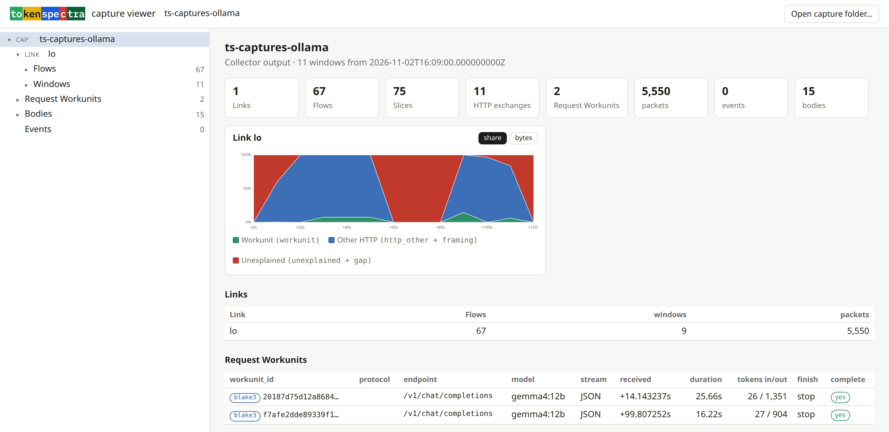

# TokenSpectra Collector

The Rust Collector for [TokenSpectra](https://github.com/tokenspectra/tokenspectra). It reads network traffic from a live interface or from pcap files. It accounts for every byte, decodes LLM requests (OpenAI, Anthropic and Ollama) into Request Workunits, and stores everything under BLAKE3 hashes as evidence an auditor can check.



## Quick start

You need Rust, [Ollama](https://ollama.com), Python 3, and `dumpcap` runnable without root (on Ubuntu: `sudo apt install wireshark-common`, answer **Yes** to non-superuser capture, then `sudo usermod -aG wireshark $USER`).

```sh
ollama pull qwen2.5:0.5b

# terminal 1: capture loopback in 10 s windows
sg wireshark -c "cargo run -- ring -i lo -w 10 -o ts-captures-demo"

# terminal 2: send some prompts
python3 tools/llm_traffic.py --stream --count 5 --interval 10
```

Press Ctrl-C in terminal 1, open `viewer/index.html` in a browser and choose `ts-captures-demo/`.

To read existing captures instead: `cargo run -- files -o out/ capture.pcapng`. Run the tests with `cargo test --workspace`.


## Command line

S3 is optional. By default the object store is a local directory, `<out>/store`, or the one `--store <dir>` names: there is no spool and no network traffic, and the S3 options (`--s3-endpoint`, `--spool`, `--spool-max-mib`, `--upload-wait-s`, `upload`) don't apply. With `--store s3://bucket[/prefix]`, objects go through a local spool to that store, and the endpoint must be named. [docs/spec.md](docs/spec.md) ("Command line") explains each option in full.

A real deployment runs under the Fleet: `--fleet` enrols the Collector, and signed config then sets the ingest and the Capture Rate. Manifests go to the ingest over mTLS. `--ingest` and `--capture-key` are development stand-ins; plain `http://` needs `--dev-plain-http`. See [docs/spec.md](docs/spec.md) §15.

<!-- help: --help -->
```text
TokenSpectra Collector

Usage: collector [OPTIONS] <COMMAND>

Commands:
  files   Assemble Flows from .pcap/.pcapng files, in the order given
  views   Rebuild by-exchange/ in an output directory
  ship    POST the manifests not shipped yet to --ingest
  upload  Upload what the spool still holds to an s3:// --store
  ring    Capture live through a dumpcap ring buffer
  help    Print this message or the help of the given subcommand(s)

Options:
  -h, --help  Print help

Global options:
      --no-bodies
          Don't keep HTTP bodies (hashes and tables stay the same)
  -v, --verbose...
          More log detail: -v DEBUG, -vv TRACE
  -q, --quiet...
          Less log detail: -q WARN, -qq ERROR
      --log-level <LOG_LEVEL>
          Log level; overrides -v/-q (RUST_LOG overrides it) [possible values: error, warn, info, debug, trace]
      --log-format <LOG_FORMAT>
          Log line format on stdout [default: text] [possible values: text, json]
      --metrics-addr <METRICS_ADDR>
          Serve Prometheus metrics here, e.g. 127.0.0.1:9464
      --store <STORE>
          Object store: a directory or s3://bucket[/prefix] [default: <out>/store]
      --s3-endpoint <S3_ENDPOINT>
          S3 endpoint; required for s3:// unless AWS_ENDPOINT is set
      --spool <SPOOL>
          Local spool for s3:// uploads [default: <out>/spool]
      --spool-max-mib <SPOOL_MAX_MIB>
          Spool cap in MiB; a full spool holds the run back [default: 4096]
      --upload-wait-s <UPLOAD_WAIT_S>
          Seconds to finish uploads at the end of a run [default: 30]
      --fleet <FLEET>
          Fleet URL to enrol with and pull config and seeds from (https://)
      --fleet-ca <FLEET_CA>
          PEM file of the CA the Fleet's and ingest's TLS chain to
      --fleet-root <FLEET_ROOT>
          The Fleet's Ed25519 public key, 64 hex digits
      --join-token-file <JOIN_TOKEN_FILE>
          File holding the site join token; needed to enrol
      --fleet-dir <FLEET_DIR>
          Fleet keys and state [default: <out>/fleet]
      --dev-plain-http
          Dev only: allow plain http:// to the ingest and the Fleet
      --ingest <INGEST>
          Dev only: plain http:// ingest URL; with --fleet, config names it
      --ship-wait-s <SHIP_WAIT_S>
          Seconds to finish shipping manifests at the end of a run [default: 30]
      --signing-key <SIGNING_KEY>
          Manifest signing key, made if missing [default: <out>/signing.key]
      --site <SITE>
          The {site} part of object keys [default: local]
      --collector-id <COLLECTOR_ID>
          The {collector} part of object keys [default: local]
      --capture-rate <CAPTURE_RATE>
          Capture Rate: share of Request Workunits kept in full (0 to 1); --fleet's config wins [default: 1]
      --capture-key <CAPTURE_KEY>
          Dev only: Capture Rate key, 64 hex digits; --fleet uses seeds
      --truncate-to <TRUNCATE_TO>
          Captured bytes left in a truncated packet [default: 128]
      --alarm-cap <ALARM_CAP>
          Alarm-packet bytes kept in full per Flow per Slice [default: 16777216]
```

<details><summary><code>collector files --help</code></summary>

<!-- help: files --help -->
```text
Assemble Flows from .pcap/.pcapng files, in the order given

Usage: collector files [OPTIONS] [FILES]...

Arguments:
  [FILES]...  Capture files

Options:
  -w, --window-s <WINDOW_S>  Window (Slice) length in seconds [default: 10]
  -o, --out <OUT>            Output directory [default: ts-captures]
  -h, --help                 Print help

Global options:
      --no-bodies
          Don't keep HTTP bodies (hashes and tables stay the same)
  -v, --verbose...
          More log detail: -v DEBUG, -vv TRACE
  -q, --quiet...
          Less log detail: -q WARN, -qq ERROR
      --log-level <LOG_LEVEL>
          Log level; overrides -v/-q (RUST_LOG overrides it) [possible values: error, warn, info, debug, trace]
      --log-format <LOG_FORMAT>
          Log line format on stdout [default: text] [possible values: text, json]
      --metrics-addr <METRICS_ADDR>
          Serve Prometheus metrics here, e.g. 127.0.0.1:9464
      --store <STORE>
          Object store: a directory or s3://bucket[/prefix] [default: <out>/store]
      --s3-endpoint <S3_ENDPOINT>
          S3 endpoint; required for s3:// unless AWS_ENDPOINT is set
      --spool <SPOOL>
          Local spool for s3:// uploads [default: <out>/spool]
      --spool-max-mib <SPOOL_MAX_MIB>
          Spool cap in MiB; a full spool holds the run back [default: 4096]
      --upload-wait-s <UPLOAD_WAIT_S>
          Seconds to finish uploads at the end of a run [default: 30]
      --fleet <FLEET>
          Fleet URL to enrol with and pull config and seeds from (https://)
      --fleet-ca <FLEET_CA>
          PEM file of the CA the Fleet's and ingest's TLS chain to
      --fleet-root <FLEET_ROOT>
          The Fleet's Ed25519 public key, 64 hex digits
      --join-token-file <JOIN_TOKEN_FILE>
          File holding the site join token; needed to enrol
      --fleet-dir <FLEET_DIR>
          Fleet keys and state [default: <out>/fleet]
      --dev-plain-http
          Dev only: allow plain http:// to the ingest and the Fleet
      --ingest <INGEST>
          Dev only: plain http:// ingest URL; with --fleet, config names it
      --ship-wait-s <SHIP_WAIT_S>
          Seconds to finish shipping manifests at the end of a run [default: 30]
      --signing-key <SIGNING_KEY>
          Manifest signing key, made if missing [default: <out>/signing.key]
      --site <SITE>
          The {site} part of object keys [default: local]
      --collector-id <COLLECTOR_ID>
          The {collector} part of object keys [default: local]
      --capture-rate <CAPTURE_RATE>
          Capture Rate: share of Request Workunits kept in full (0 to 1); --fleet's config wins [default: 1]
      --capture-key <CAPTURE_KEY>
          Dev only: Capture Rate key, 64 hex digits; --fleet uses seeds
      --truncate-to <TRUNCATE_TO>
          Captured bytes left in a truncated packet [default: 128]
      --alarm-cap <ALARM_CAP>
          Alarm-packet bytes kept in full per Flow per Slice [default: 16777216]
```

</details>

<details><summary><code>collector views --help</code></summary>

<!-- help: views --help -->
```text
Rebuild by-exchange/ in an output directory

Usage: collector views [OPTIONS] [OUT]

Arguments:
  [OUT]  Output directory [default: ts-captures]

Options:
  -h, --help  Print help

Global options:
      --no-bodies
          Don't keep HTTP bodies (hashes and tables stay the same)
  -v, --verbose...
          More log detail: -v DEBUG, -vv TRACE
  -q, --quiet...
          Less log detail: -q WARN, -qq ERROR
      --log-level <LOG_LEVEL>
          Log level; overrides -v/-q (RUST_LOG overrides it) [possible values: error, warn, info, debug, trace]
      --log-format <LOG_FORMAT>
          Log line format on stdout [default: text] [possible values: text, json]
      --metrics-addr <METRICS_ADDR>
          Serve Prometheus metrics here, e.g. 127.0.0.1:9464
      --store <STORE>
          Object store: a directory or s3://bucket[/prefix] [default: <out>/store]
      --s3-endpoint <S3_ENDPOINT>
          S3 endpoint; required for s3:// unless AWS_ENDPOINT is set
      --spool <SPOOL>
          Local spool for s3:// uploads [default: <out>/spool]
      --spool-max-mib <SPOOL_MAX_MIB>
          Spool cap in MiB; a full spool holds the run back [default: 4096]
      --upload-wait-s <UPLOAD_WAIT_S>
          Seconds to finish uploads at the end of a run [default: 30]
      --fleet <FLEET>
          Fleet URL to enrol with and pull config and seeds from (https://)
      --fleet-ca <FLEET_CA>
          PEM file of the CA the Fleet's and ingest's TLS chain to
      --fleet-root <FLEET_ROOT>
          The Fleet's Ed25519 public key, 64 hex digits
      --join-token-file <JOIN_TOKEN_FILE>
          File holding the site join token; needed to enrol
      --fleet-dir <FLEET_DIR>
          Fleet keys and state [default: <out>/fleet]
      --dev-plain-http
          Dev only: allow plain http:// to the ingest and the Fleet
      --ingest <INGEST>
          Dev only: plain http:// ingest URL; with --fleet, config names it
      --ship-wait-s <SHIP_WAIT_S>
          Seconds to finish shipping manifests at the end of a run [default: 30]
      --signing-key <SIGNING_KEY>
          Manifest signing key, made if missing [default: <out>/signing.key]
      --site <SITE>
          The {site} part of object keys [default: local]
      --collector-id <COLLECTOR_ID>
          The {collector} part of object keys [default: local]
      --capture-rate <CAPTURE_RATE>
          Capture Rate: share of Request Workunits kept in full (0 to 1); --fleet's config wins [default: 1]
      --capture-key <CAPTURE_KEY>
          Dev only: Capture Rate key, 64 hex digits; --fleet uses seeds
      --truncate-to <TRUNCATE_TO>
          Captured bytes left in a truncated packet [default: 128]
      --alarm-cap <ALARM_CAP>
          Alarm-packet bytes kept in full per Flow per Slice [default: 16777216]
```

</details>

<details><summary><code>collector ship --help</code></summary>

<!-- help: ship --help -->
```text
POST the manifests not shipped yet to --ingest

Usage: collector ship [OPTIONS] [OUT]

Arguments:
  [OUT]  Output directory [default: ts-captures]

Options:
  -h, --help  Print help

Global options:
      --no-bodies
          Don't keep HTTP bodies (hashes and tables stay the same)
  -v, --verbose...
          More log detail: -v DEBUG, -vv TRACE
  -q, --quiet...
          Less log detail: -q WARN, -qq ERROR
      --log-level <LOG_LEVEL>
          Log level; overrides -v/-q (RUST_LOG overrides it) [possible values: error, warn, info, debug, trace]
      --log-format <LOG_FORMAT>
          Log line format on stdout [default: text] [possible values: text, json]
      --metrics-addr <METRICS_ADDR>
          Serve Prometheus metrics here, e.g. 127.0.0.1:9464
      --store <STORE>
          Object store: a directory or s3://bucket[/prefix] [default: <out>/store]
      --s3-endpoint <S3_ENDPOINT>
          S3 endpoint; required for s3:// unless AWS_ENDPOINT is set
      --spool <SPOOL>
          Local spool for s3:// uploads [default: <out>/spool]
      --spool-max-mib <SPOOL_MAX_MIB>
          Spool cap in MiB; a full spool holds the run back [default: 4096]
      --upload-wait-s <UPLOAD_WAIT_S>
          Seconds to finish uploads at the end of a run [default: 30]
      --fleet <FLEET>
          Fleet URL to enrol with and pull config and seeds from (https://)
      --fleet-ca <FLEET_CA>
          PEM file of the CA the Fleet's and ingest's TLS chain to
      --fleet-root <FLEET_ROOT>
          The Fleet's Ed25519 public key, 64 hex digits
      --join-token-file <JOIN_TOKEN_FILE>
          File holding the site join token; needed to enrol
      --fleet-dir <FLEET_DIR>
          Fleet keys and state [default: <out>/fleet]
      --dev-plain-http
          Dev only: allow plain http:// to the ingest and the Fleet
      --ingest <INGEST>
          Dev only: plain http:// ingest URL; with --fleet, config names it
      --ship-wait-s <SHIP_WAIT_S>
          Seconds to finish shipping manifests at the end of a run [default: 30]
      --signing-key <SIGNING_KEY>
          Manifest signing key, made if missing [default: <out>/signing.key]
      --site <SITE>
          The {site} part of object keys [default: local]
      --collector-id <COLLECTOR_ID>
          The {collector} part of object keys [default: local]
      --capture-rate <CAPTURE_RATE>
          Capture Rate: share of Request Workunits kept in full (0 to 1); --fleet's config wins [default: 1]
      --capture-key <CAPTURE_KEY>
          Dev only: Capture Rate key, 64 hex digits; --fleet uses seeds
      --truncate-to <TRUNCATE_TO>
          Captured bytes left in a truncated packet [default: 128]
      --alarm-cap <ALARM_CAP>
          Alarm-packet bytes kept in full per Flow per Slice [default: 16777216]
```

</details>

<details><summary><code>collector upload --help</code></summary>

<!-- help: upload --help -->
```text
Upload what the spool still holds to an s3:// --store

Usage: collector upload [OPTIONS] [OUT]

Arguments:
  [OUT]  Output directory [default: ts-captures]

Options:
  -h, --help  Print help

Global options:
      --no-bodies
          Don't keep HTTP bodies (hashes and tables stay the same)
  -v, --verbose...
          More log detail: -v DEBUG, -vv TRACE
  -q, --quiet...
          Less log detail: -q WARN, -qq ERROR
      --log-level <LOG_LEVEL>
          Log level; overrides -v/-q (RUST_LOG overrides it) [possible values: error, warn, info, debug, trace]
      --log-format <LOG_FORMAT>
          Log line format on stdout [default: text] [possible values: text, json]
      --metrics-addr <METRICS_ADDR>
          Serve Prometheus metrics here, e.g. 127.0.0.1:9464
      --store <STORE>
          Object store: a directory or s3://bucket[/prefix] [default: <out>/store]
      --s3-endpoint <S3_ENDPOINT>
          S3 endpoint; required for s3:// unless AWS_ENDPOINT is set
      --spool <SPOOL>
          Local spool for s3:// uploads [default: <out>/spool]
      --spool-max-mib <SPOOL_MAX_MIB>
          Spool cap in MiB; a full spool holds the run back [default: 4096]
      --upload-wait-s <UPLOAD_WAIT_S>
          Seconds to finish uploads at the end of a run [default: 30]
      --fleet <FLEET>
          Fleet URL to enrol with and pull config and seeds from (https://)
      --fleet-ca <FLEET_CA>
          PEM file of the CA the Fleet's and ingest's TLS chain to
      --fleet-root <FLEET_ROOT>
          The Fleet's Ed25519 public key, 64 hex digits
      --join-token-file <JOIN_TOKEN_FILE>
          File holding the site join token; needed to enrol
      --fleet-dir <FLEET_DIR>
          Fleet keys and state [default: <out>/fleet]
      --dev-plain-http
          Dev only: allow plain http:// to the ingest and the Fleet
      --ingest <INGEST>
          Dev only: plain http:// ingest URL; with --fleet, config names it
      --ship-wait-s <SHIP_WAIT_S>
          Seconds to finish shipping manifests at the end of a run [default: 30]
      --signing-key <SIGNING_KEY>
          Manifest signing key, made if missing [default: <out>/signing.key]
      --site <SITE>
          The {site} part of object keys [default: local]
      --collector-id <COLLECTOR_ID>
          The {collector} part of object keys [default: local]
      --capture-rate <CAPTURE_RATE>
          Capture Rate: share of Request Workunits kept in full (0 to 1); --fleet's config wins [default: 1]
      --capture-key <CAPTURE_KEY>
          Dev only: Capture Rate key, 64 hex digits; --fleet uses seeds
      --truncate-to <TRUNCATE_TO>
          Captured bytes left in a truncated packet [default: 128]
      --alarm-cap <ALARM_CAP>
          Alarm-packet bytes kept in full per Flow per Slice [default: 16777216]
```

</details>

<details><summary><code>collector ring --help</code></summary>

<!-- help: ring --help -->
```text
Capture live through a dumpcap ring buffer

Usage: collector ring [OPTIONS] --interface <INTERFACE>

Options:
  -w, --window-s <WINDOW_S>      Window (Slice) length in seconds; also dumpcap's ring interval [default: 10]
  -i, --interface <INTERFACE>    Capture interface; it becomes the Link id
  -d, --ring-dir <RING_DIR>      Ring file directory [default: <tmp>/tokenspectra-ring-<interface>]
  -t, --duration-s <DURATION_S>  Stop after this many seconds
  -f, --filter <FILTER>          Capture filter (dumpcap -f)
  -B, --buffer-mib <BUFFER_MIB>  Kernel capture buffer in MiB (dumpcap -B)
      --dumpcap <DUMPCAP>        The dumpcap binary [default: dumpcap]
  -o, --out <OUT>                Output directory [default: ts-captures]
  -h, --help                     Print help

Global options:
      --no-bodies
          Don't keep HTTP bodies (hashes and tables stay the same)
  -v, --verbose...
          More log detail: -v DEBUG, -vv TRACE
  -q, --quiet...
          Less log detail: -q WARN, -qq ERROR
      --log-level <LOG_LEVEL>
          Log level; overrides -v/-q (RUST_LOG overrides it) [possible values: error, warn, info, debug, trace]
      --log-format <LOG_FORMAT>
          Log line format on stdout [default: text] [possible values: text, json]
      --metrics-addr <METRICS_ADDR>
          Serve Prometheus metrics here, e.g. 127.0.0.1:9464
      --store <STORE>
          Object store: a directory or s3://bucket[/prefix] [default: <out>/store]
      --s3-endpoint <S3_ENDPOINT>
          S3 endpoint; required for s3:// unless AWS_ENDPOINT is set
      --spool <SPOOL>
          Local spool for s3:// uploads [default: <out>/spool]
      --spool-max-mib <SPOOL_MAX_MIB>
          Spool cap in MiB; a full spool holds the run back [default: 4096]
      --upload-wait-s <UPLOAD_WAIT_S>
          Seconds to finish uploads at the end of a run [default: 30]
      --fleet <FLEET>
          Fleet URL to enrol with and pull config and seeds from (https://)
      --fleet-ca <FLEET_CA>
          PEM file of the CA the Fleet's and ingest's TLS chain to
      --fleet-root <FLEET_ROOT>
          The Fleet's Ed25519 public key, 64 hex digits
      --join-token-file <JOIN_TOKEN_FILE>
          File holding the site join token; needed to enrol
      --fleet-dir <FLEET_DIR>
          Fleet keys and state [default: <out>/fleet]
      --dev-plain-http
          Dev only: allow plain http:// to the ingest and the Fleet
      --ingest <INGEST>
          Dev only: plain http:// ingest URL; with --fleet, config names it
      --ship-wait-s <SHIP_WAIT_S>
          Seconds to finish shipping manifests at the end of a run [default: 30]
      --signing-key <SIGNING_KEY>
          Manifest signing key, made if missing [default: <out>/signing.key]
      --site <SITE>
          The {site} part of object keys [default: local]
      --collector-id <COLLECTOR_ID>
          The {collector} part of object keys [default: local]
      --capture-rate <CAPTURE_RATE>
          Capture Rate: share of Request Workunits kept in full (0 to 1); --fleet's config wins [default: 1]
      --capture-key <CAPTURE_KEY>
          Dev only: Capture Rate key, 64 hex digits; --fleet uses seeds
      --truncate-to <TRUNCATE_TO>
          Captured bytes left in a truncated packet [default: 128]
      --alarm-cap <ALARM_CAP>
          Alarm-packet bytes kept in full per Flow per Slice [default: 16777216]
```

</details>
